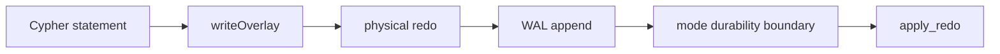

# Relate engine architecture

This page is the engine overview. Decision records live in
[`docs/adr/`](adr/). The [README](../README.md) is the short version.

1. [Position and crate map](#position-and-crate-map)
2. [In-memory graph](#in-memory-graph)
3. [Persistence](#persistence)
4. [Writes](#writes)
5. [Querying](#querying)
6. [Planner](#planner)
7. [Indexes](#indexes)

```mermaid
flowchart LR
  parse[parser]
  plan[planner]
  exec[executor]
  graph[inMemoryGraph]
  wal[WAL]
  snap[snapshot]
  parse --> plan --> exec
  exec --> graph
  exec -->|"redo"| wal
  wal -->|"apply_redo"| graph
  snap -->|"open plus replay"| graph
  graph -->|"checkpoint"| snap
```

## Position and crate map

Relate is an **embedded, in-memory labeled property graph**. The
working set is RAM. Durable form is a fsync’d local WAL plus Parquet
checkpoints on a local path. The language contract is
the **openCypher TCK** (pinned release), not Neo4j Cypher and not ISO
GQL. Remote access is **Bolt as a transport**. Multi-language clients
wrap a **C ABI**; they do not invent a parallel protocol. One library
(`relate-ffi`) exposes the typed C ABI v2 under `relate_*`
(ADR-0054, ADR-0502): one tabular database/connection/result API, a native
value walker that reports each value's kind at every depth, a typed params
builder, and one structured error shape that travels with each fallible
call. The v1 JSON handle API and the thread-local last-error slot were
removed in v2.

One Cargo workspace; every crate lives under one of three groups
([ADR-0103](adr/0103-engine-surfaces-testing-layout.md)). Engine crates
depend only on engine crates; surfaces depend on the engine and other
surfaces; testing may depend on anything (`cargo xtask check-boundaries`).

```
relate/                          the engine
  relate                         public Rust API (`relate::Database`)
  relate-model                   data model types (`CypherValue`)
  relate-parser                  Cypher lexer, parser, AST
  relate-error                   typed engine errors (`EngineError`)
  relate-core                    values, errors, IDs, config
  relate-catalog                 interned labels, rel types, property keys
  relate-ir                      planner AST (not the query front-end)
  relate-front                   Relate parser → planner IR
  relate-planner                 bind + logical plan + MATCH rewrite
  relate-executor                physical execution + live graph
  relate-storage                 WAL + snapshot codecs (Parquet behind default `parquet` feature, JSON GraphData)
  relate-splitter                shared statement splitting / input completeness

surfaces/                        adapters of `relate::Database`
  relate-cli                     Cypher shell (binary `relate`)
  relate-bolt                    Bolt server
  relate-python                  Python bindings (pyo3, DB-API)
  relate-ffi                     product C ABI (`relate_*`)
  relate-wasm                    browser bindings (wasm-bindgen)
  relate-formatter               result output formats (table, CSV, JSON, JSONL, …)
  relate-load                    Neo4j/Aura Query API v2 → CREATE into Database
  relate-arrow                   CypherValue ↔ Arrow RecordBatch conversion

testing/                         conformance, evaluation, datasets, tooling
  relate-datasets                synthetic graphs + loadtest binaries
  relate-test-support            shared test-only helpers (big-stack runner)
  xtask                          boundary check (`cargo xtask check-boundaries`)
```

Schema is optional: labels and relationship types do not need DDL.
Properties are mixed-type maps (TCK). Apache-2.0.

**ADRs:** [0055](adr/0055-apache-2-license.md) license,
[0056](adr/0056-opencypher-tck-language-contract.md) TCK dialect,
[0057](adr/0057-embedded-c-abi-and-bolt.md) C ABI and Bolt.

## In-memory graph

The live store is the source of query execution. Parquet is a snapshot
of already-committed state, not a file the matcher scans.

**Records.** Labels, relationship types, and property keys are interned.
A live node is interned label ids plus a compact property list. A
relationship payload is either a compact list or a fixed three-key
shape (`id` / `amount` / `ts`) used by the fraud graph. Public
`Node` / `Relationship` maps are materialized at `node_at` / `rel_at`,
checkpoint encode, and overlay copy-on-write.

**Adjacency.** Out- and in-edges are **typed adjacency chunks**: per node,
interned `type_id → Vec<RelId>` — sorted hop vectors per (node, type), not a
shared-offset CSR layout. An expand with `[:TRANSFER]` walks that
partition only. A bare `-[]-` visits every partition. The lists are a
**visibility superset**: delete does not punch a hole; `rel_at` at
`snapshot_ts` decides if the edge is live.

**MVCC.** Each stored version has `xmin` / `xmax`. `xmax = 0` means
live. `SET` / `REMOVE` install a new version of the same Cypher id;
`DELETE` sets `xmax`. A reader pins `snapshot_ts` and uses
`xmin <= snapshot_ts && (xmax == 0 || xmax > snapshot_ts)`. It does
not clone the graph. Public values do not expose xmin/xmax.

**Pins and concurrency.** Snapshot pins are a lock-free slot table
(256 `AtomicU64` slots). The query path does not take a database
`RwLock`. Readers and one `apply_redo` can run together; the WAL
still serializes apply. Incremental GC drops versions that no pin
still needs (`xmax` at or below the horizon).

**ADRs:** [0013](adr/0013-tuple-mvcc.md) xmin/xmax,
[0018](adr/0018-concurrent-snapshot-reads.md) apply during reads,
[0023](adr/0023-incremental-version-gc.md) GC horizon,
[0031](adr/0031-typed-adjacency.md) per-type adj,
[0033](adr/0033-compact-live-records-typed-csr.md) intern + typed adjacency,
[0038](adr/0038-lock-free-snapshot-pins.md) pin table.

## Persistence

There is **one** way to obtain a live graph and **one** write path
([ADR-0014](adr/0014-single-wal-write-path.md)):

1. **Materialize** — load the snapshot (codec-owned store files), then replay WAL records
   with `lsn > checkpoint_lsn`.
2. **Commit** — append physical redo to the WAL, then `apply_redo`.
   The live graph is never the source of a commit.
3. **Snapshot** — checkpoint writes store files from the already-applied
   committed graph (rows visible at the checkpoint pin) and recycles
   the WAL. WAL format and this choreography do not change with the codec
   ([ADR-0050](adr/0050-snapshot-codecs.md)).

`:memory:` uses the same types in-process (`MemoryVfs` and
WAL). It is process-ephemeral: nothing on disk, `checkpoint()` does
not create OS files. Its automatic checkpoints (WAL rotation, close)
skip the dump and only recycle the WAL; an explicit `checkpoint()`
still writes an in-process snapshot (ADR-0105). Directory paths use `NativeVfs`; a path ending in
`.rl` uses `BundleVfs` (ADR-0072, ADR-0074).

**Snapshot codecs.** `manifest.json` records `codec` (`parquet` when
absent, in every build) and `checkpoint_lsn`. One codec per directory;
mixing Parquet objects with `graph.json` is an error. Empty URIs take
`OpenOptions.snapshot_codec` / `RELATE_SNAPSHOT_FORMAT` / the build
default: Parquet with the default-on `parquet` Cargo feature, JSON
without it. A build without the feature refuses Parquet stores and
Parquet requests at open with a typed storage error; it never falls
back to JSON ([ADR-0105](adr/0105-optional-parquet-codec.md)). Every
checkpoint of every codec — Parquet, JSON, and the markdown vault —
also rewrites the store's schema text mirror under
`.cypherlite/schema/` ([ADR-0481](adr/0481-schema-as-files.md)): the
canonical graph type body, the verbatim ontology document, and one
SHOW-rendered `CREATE` statement per renderable catalog entry in the
catalog's name order. The manifest and WAL stay authoritative; at open
the mirror is verified against the checkpointed state and any drift
fails closed naming the file. See the
[schema folder guide](guides/schema-as-files.md).

**Parquet layout (default, `parquet` feature).** Logical model is LPG (integer ids, labels, types,
property maps). A snapshot directory has
`manifest.json` plus node and relationship parts. Properties are tagged
JSON so a key can mix TCK types. Current manifests list **id-window
shards** (`nodes/{lo}-{hi}.parquet`, same for relationships) so a
checkpoint rewrites dirty ranges instead of the whole graph. A
checkpoint coalesces a rewritten id range with its undersized neighbors
into byte-budgeted shards
([ADR-0183](adr/0183-coalesce-checkpoint-shards.md)). Legacy
single `nodes.parquet` / `relationships.parquet` still load.

**JSON layout.** Relate GraphData in `graph.json` (full rewrite each
checkpoint). Properties use `__type` tags. Import an existing `.db`
document by copying it to `<dir>/graph.json`.

**WAL.** Redo is physical graph ops (create/delete node and rel,
set/remove property, add/remove label), not Cypher text. Filesystem
URI: segments live at `<dir>/wal/NNNNNNNN.log` (or `--wal-dir`). Open
loads the latest snapshot and replays that local log.

**Checkpoint** is rotate, dump, recycle — not stop-the-world truncate.
The open WAL segment closes when it hits **64 MiB**, **10 000 commits**,
or a **timer** (default 300 s, `RELATE_CHECKPOINT_INTERVAL_SECS`;
`0` disables the clock) if that segment has records or a closed
segment is waiting (ADR-0041). Writers continue on the next number.
Dump uses the same snapshot visibility as readers. Local checkpoints
use tmp + rename. Persistent URIs also checkpoint on close. `:memory:`
has no timer, and its rotation and close checkpoints recycle without
a dump. Closed segments with `max_lsn <= checkpoint_lsn` are
deleted (ADR-0020).

**Memory cap.** Optional logical limit on the live graph and
data-dependent indexes (ADR-0042), not process RSS. Growing writes
that would exceed it fail with `Error::Capacity` at WAL append.
`DELETE` and shrinking `SET` stay allowed. Open and replay always
apply, even when the snapshot is already over the limit.
`RELATE_LOGICAL_GRAPH_SIZE_LIMIT` / `--logical-graph-size-limit` / `OpenOptions.logical_graph_size_limit`.
The flag and env accept bytes or `mb`/`mib`/`gb`/`gib`.
Executing queries are admitted the same way (ADR-0452):
`RELATE_CONCURRENT_LOGICAL_WORKSPACE_LIMIT` / `--concurrent-logical-workspace-limit` / `OpenOptions.concurrent_logical_workspace_limit`.
A positive size turns the pool on; unset leaves it off.

**ADRs:** [0004](adr/0004-memory-first-parquet-object-store.md)
memory-first (superseded in part by 0012),
[0005](adr/0005-lpg-parquet-layout.md) columns,
[0012](adr/0012-wal-and-parquet-checkpoints.md) WAL-first,
[0014](adr/0014-single-wal-write-path.md) one path,
[0020](adr/0020-segmented-wal-concurrent-checkpoint.md) segments,
[0022](adr/0022-id-window-checkpoint-shards.md) shards,
[0041](adr/0041-timed-checkpoint.md) timed dump,
[0042](adr/0042-graph-memory-limit.md) logical cap,
[0050](adr/0050-snapshot-codecs.md) snapshot codecs.

## Writes

Default isolation is **auto-commit**: one Cypher statement is one WAL
commit. Isolation for readers is snapshot at statement (or transaction)
start.

**Statement execute.** A writer pins `snapshot_ts` and runs against the
live `Graph` plus a private **write overlay** (`WriteScratch`). MATCH
in the same statement sees overlay first, then the snapshot. Overlay
is dropped on abort. Success evaluates the overlay into physical redo.

**Publish.** WAL append is the serialize point that assigns
`commit_ts`. In `full` durability (the default), the accepted group is
barriered before `apply_redo`; `everysecond` and `snapshot` apply immediately
and acknowledge before stable storage. Then `apply_redo` installs versions
and updates indexes and adjacency. The overlay is not a graph clone. Node and relationship
ids come from process-wide atomics so concurrent creates do not
collide.

**Optimistic write-write.** Two statements that overlap in their write
sets conflict at WAL append, and commit admission rejects a slot that would
introduce a `unique`/`key` constrained tuple another live entity already
holds (ADR-0439). Either way the engine returns `Error::Conflict`
(`write-write conflict`) and does **not** retry. The client retries,
aborts, or compensates; a retried uniqueness-admission statement then sees
the winner and reports the precise `ConstraintValidationFailed` violation.
In `full`, independent waiting appends **share one
durability barrier** (group commit). `everysecond` barriers all dirty WAL
records approximately once per second and accepts loss of the latest
approximately one-second interval. `snapshot` does not barrier the WAL and
accepts loss of all writes since the latest completed checkpoint.

**Explicit transactions.** `BEGIN` pins `snapshot_ts = last_committed`
and holds that pin until `COMMIT` or `ROLLBACK`. Statements in the
transaction see their own overlay. `COMMIT` appends the combined redo
once. OpenCypher TCK scenarios stay auto-commit.



**ADRs:** [0015](adr/0015-optimistic-wal-commits.md) commit_ts at
append, [0016](adr/0016-write-overlay.md) overlay,
[0017](adr/0017-client-conflict.md) Conflict,
[0019](adr/0019-group-commit-shared-fsync.md) group commit,
[0028](adr/0028-user-visible-transactions.md) BEGIN/COMMIT,
[0439](adr/0439-commit-time-uniqueness.md) commit-time uniqueness admission.

## Querying

Pipeline: **parse → bind → plan → execute**.

The product parser is a recursive-descent OpenCypher grammar in
`relate-parser`. `relate-front` lowers that AST to planner IR
(`relate-ir`). Bind resolves names and types against the catalog
without executing. The planner emits a `LogicalPlan`. The executor
interprets that plan against the pinned snapshot.

**MATCH.** After rewrite (below), the first node is an index seek, a
label scan, or an all-node scan. Each hop expands the typed adjacency
partition and checks `rel_at` visibility. Residual `WHERE` conjuncts
run when every variable they mention is bound, not only after the
full path. Relationship equality in `WHERE` folds into the rel map
the same way node equality folds into the node map.

Rows keep only **live variables** between clauses; projection does
not clone the full input row.

**Operators worth calling out.** One-hop aggregates
(`sum` / `count` / `CASE` + `count` over a bound node’s out-edges)
can fold while walking adjacency instead of allocating one row per
edge. Expand that is ordered by a relationship property (`ORDER BY
t.ts`) can walk a sorted view of that type’s chunk. `shortestPath` /
`allShortestPaths` are **BFS**, not “expand every trail then keep the
shortest”, both as expressions and in the `MATCH` clause forms
(`MATCH p = shortestPath(...)`). The simple GQL shortest selectors
(`ANY SHORTEST`, `SHORTEST 1`, `SHORTEST 1 GROUP`, `ALL SHORTEST`) over
one variable-length relationship use the same BFS. Other selector
shapes still enumerate, then select. Both forms share one search
module, `relate-executor/src/shortest/`: a pair search for one
shortest path between two bound ends (bidirectional, or a shallow
intersection for a small hop bound), and a layered search for
one-to-many, all-shortest and closed paths. An expression with
`min_hops` > 1 enumerates exactly instead.

**ADRs:** [0007](adr/0007-recursive-descent-parser.md) parser,
[0021](adr/0021-opencypher-temporal-values.md) temporals,
[0025](adr/0025-shortestpath-bfs.md) BFS,
[0026](adr/0026-eager-residual-match-predicates.md) residual WHERE,
[0027](adr/0027-live-row-variables.md) live vars,
[0034](adr/0034-bidirectional-shortestpath.md) bi-BFS,
[0035](adr/0035-ordered-expand-ts.md) ordered expand,
[0036](adr/0036-fold-one-hop-aggregates.md) agg fold,
[0037](adr/0037-shallow-bound-shortestpath.md) shallow bound,
[0186](adr/0186-match-clause-shortest-path-bfs.md) MATCH-clause BFS,
[0189](adr/0189-shared-shortest-path-search.md) shared search.

## Planner

`relate-planner` is a real pass. The executor consumes `LogicalPlan`,
not the AST, so rewrites do not change the parser.

v1 **validates**, then **rewrites MATCH / OPTIONAL MATCH** only.
`WITH`, writes, and `UNION` keep clause order. There is **no cost
model** and no LLVM / DataFusion backend.

MATCH rewrite, in order:

1. **Fold.** Top-level AND-equality `n.k = literal|$param` and
   `n:Label` on a node introduced in this MATCH merge into that
   node’s label list / property map so `lookup_nodes` is an index
   seek. Residual `WHERE` stays on the clause.
2. **Orient.** For a connected path with no path variable, compare
   seed scores of the endpoints. If the last node is strictly more
   selective, reverse the path and flip hop directions. Middle
   starts are out of scope (left-to-right matcher).
3. **Order.** Disconnected comma patterns are stable-sorted by the
   seed score of each path’s first node, most selective first.

Seed score, highest first: already-bound variable, then
label+equality map, then label only, then bare node.

**ADRs:** [0009](adr/0009-logical-planner.md) LogicalPlan,
[0024](adr/0024-match-rewrite-planner.md) fold / orient / order.

## Indexes

Access methods are an **engine implementation detail**. MATCH seeks
whether or not a named catalog entry exists. Mutations (create, SET,
REMOVE, DELETE) and Parquet load through `create_node` keep postings
current. Index postings are a **superset**; the executor filters by
snapshot visibility (and overlay, on writes).

`CREATE INDEX` / `DROP INDEX` / `SHOW INDEXES` ([ADR-0040](adr/0040-create-drop-index.md))
name a single `(label, property)` pair. They do not enable or disable
seeks. Names persist in the WAL and in `manifest.json` `indexes`.

| Access method | Key | Used for |
| --- | --- | --- |
| Label | label → node ids | `(:Person)` scan |
| Equality | (label, property key, literal) → ids | `{id: $id}`, `n.k = $q` |
| Prefix | (label, key) → `BTreeMap` of string → ids | `STARTS WITH` |
| Trigram | overlapping width-3 character grams; shorter needles scan | `CONTAINS` |

`STARTS WITH` is a range on the prefix map, then a `starts_with`
check at `snapshot_ts`. A `CONTAINS` needle of three or more characters
intersects that needle’s width-3 grams, then verifies `contains`. A
shorter needle, including the empty needle, does not seek; it falls
back to the label scan.

Prefix and trigram postings are **lazy**
([ADR-0063](adr/0063-lazy-string-index-postings.md)): a `(label, key)` pair
is materialized on its first `CONTAINS` / `STARTS WITH` seek and caught up
incrementally from a per-pair dirty set on later writes, instead of being
gram-split on every write.

Relationship-type “indexes” are the typed adjacency partitions
([ADR-0031](adr/0031-typed-adjacency.md)), not a Cypher schema object.

**ADRs:** [0010](adr/0010-label-property-indexes.md) label + equality,
[0030](adr/0030-string-prefix-trigram-indexes.md) prefix + trigram,
[0063](adr/0063-lazy-string-index-postings.md) lazy string postings,
[0207](adr/0207-packed-text-trigrams.md) packed width-3 text postings,
[0040](adr/0040-create-drop-index.md) named catalog DDL.
